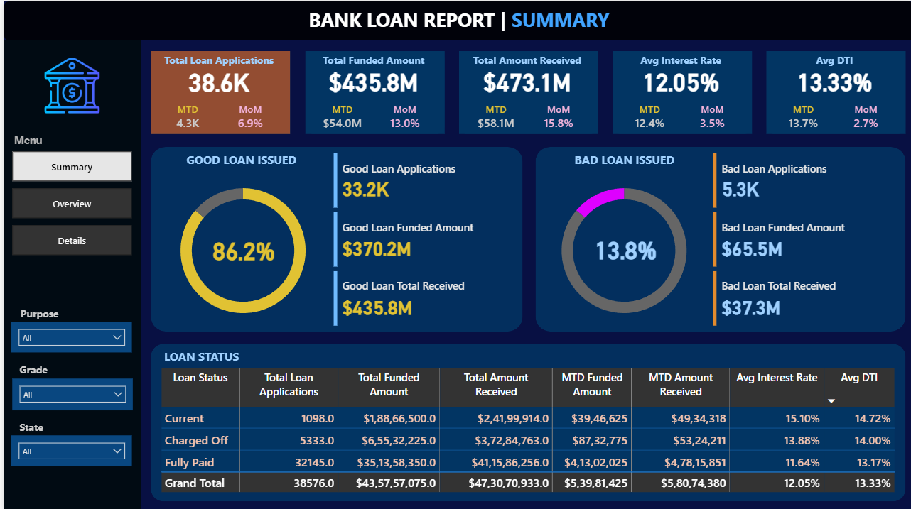
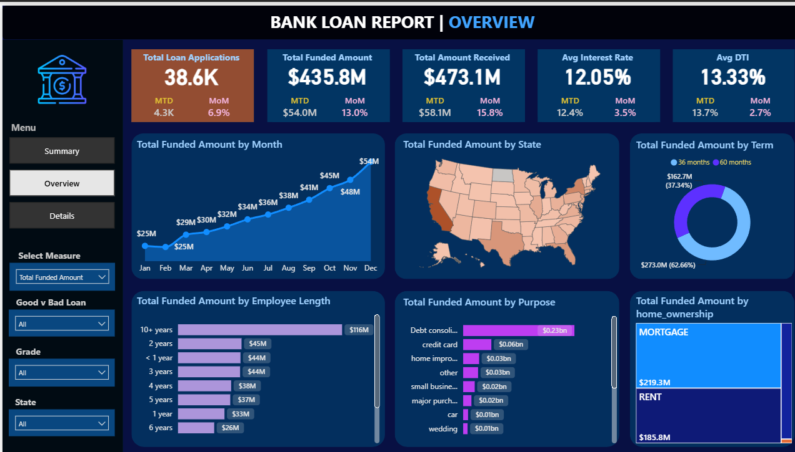

# Bank_Loan-Project
Recently I analysis 1 year bank_loan dataset to analyze overall financial activities . An interactive Bank Loan Analysis Dashboard built using SQL Server, Power BI, and Power Query. Analyzes loan applications, funded amounts, received payments, interest rates, DTI, loan performance, and customer trends . through charts and kpi's.

# Bank Loan Analysis Dashboard

## Project Overview

This project focuses on analyzing bank loan data to understand loan applications, funded amounts, received payments, borrower performance, and loan distribution. The dashboard was developed using **SQL Server, Power Query, and Power BI** to transform raw loan data into meaningful business insights.

The report contains two interactive pages: **Summary** and **Overview**, allowing users to explore loan performance through KPIs, visualizations, and filters.

---

## Key Performance Indicators (KPIs)

**Total Loan Applications: 38.6K | Total Funded Amount: $435.8M | Total Amount Received: $473.1M | Average Interest Rate: 12.05% | Average DTI: 13.33%**

---

## Dashboard Pages

### 1. Summary

The Summary page provides a high-level view of good and bad loan performance, along with a loan status breakdown.

**Key Metrics:**
- Good Loan Applications: 33.2K
- Good Loan Funded Amount: $370.2M
- Good Loan Total Received: $435.8M
- Bad Loan Applications: 5.3K
- Bad Loan Funded Amount: $65.5M
- Bad Loan Total Received: $37.3M

### 2. Overview

The Overview page provides a detailed analysis of loan distribution and funding trends across different dimensions.

---

## Charts & Visualizations

- **Line Chart:** Total Funded Amount by Month
- **Filled Map:** Total Funded Amount by State
- **Doughnut Chart:** Total Funded Amount by Loan Term
- **Bar Chart:** Total Funded Amount by Employee Length
- **Bar Chart:** Total Funded Amount by Loan Purpose
- **Treemap:** Total Funded Amount by Home Ownership
- **Doughnut Charts:** Good Loan vs. Bad Loan Distribution

---

## Loan Status Analysis

A detailed table provides a comparison of loan performance across different statuses:

- Current
- Charged Off
- Fully Paid

**Metrics included:** Total Loan Applications, Total Funded Amount, Total Amount Received, MTD Funded Amount, MTD Amount Received, Average Interest Rate, and Average DTI.

---

## Interactive Filters & Slicers

The dashboard includes interactive filters to explore loan data from different perspectives:

- Purpose
- Grade
- State
- Good vs. Bad Loan
- Select Measure

---

## Key Business Insights

- Good loans account for approximately **86.2%** of loan applications, while bad loans account for approximately **13.8%**.
- The total funded amount is approximately **$435.8M**.
- The total amount received is approximately **$473.1M**.
- Mortgage and rent are prominent home ownership categories in the funded amount analysis.
- Debt consolidation is the leading loan purpose by funded amount in the displayed overview.

---

## Data Preparation & Workflow

1. Imported the raw CSV dataset into SQL Server.
2. Used SQL queries to inspect, clean, and prepare the data for analysis.
3. Connected Power BI to SQL Server to retrieve the prepared data.
4. Used Power Query for data transformation and preparation.
5. Built the dashboard using KPIs, charts, tables, and interactive slicers.

---

## Tools & Technologies

- **SQL Server:** Data import, querying, and data preparation.
- **Power BI:** Dashboard development and data visualization.
- **Power Query:** Data cleaning and transformation.
- **CSV:** Source data format.

---

## Dashboard Screenshots

### Summary Page

### summary Page

---

## Project Objective

The objective of this project is to transform raw bank loan data into an interactive reporting solution that helps users monitor loan performance, evaluate good and bad loans, identify funding trends, and explore loan distribution across different categories.

---

**Project Type:** Data Analytics | Business Intelligence | Dashboard Reporting
